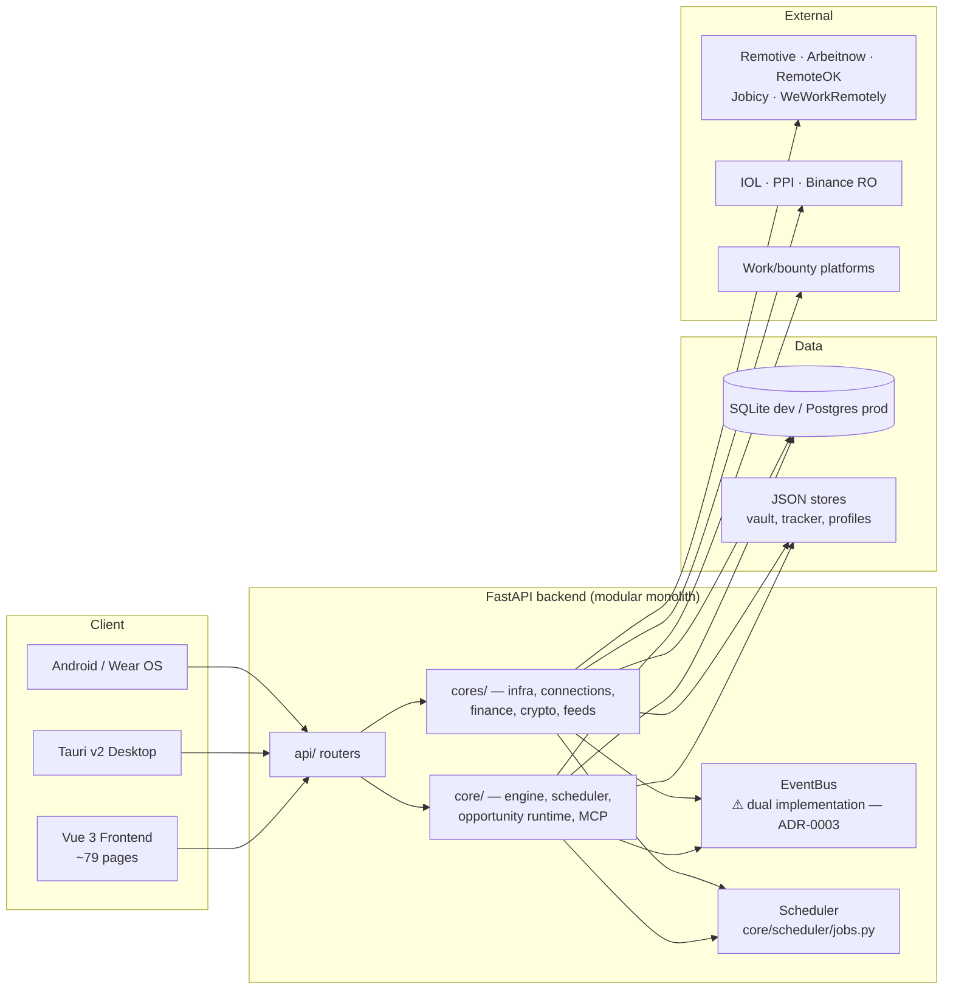

# OWNEX — Personal Semi-Autonomous Work & Intelligence Operating System

**Version:** 9.0.0 · **Python:** 3.11+ · **Stack:** FastAPI · Vue 3 · TypeScript · Tauri v2

OWNEX is a local-first personal operating system that coordinates work discovery,
application preparation, income tracking, finance, and investments — with explicit
human approval for every action that moves money or submits work.

It is not a chatbot, not a dashboard, and not a catalog of integrations. It is a
modular monolith: one FastAPI backend, an event-driven core, a Vue frontend, and
optional desktop/mobile shells — running on your machine by default.

**Core principles:** Freedom first · Zero barrier entry · Maximum value generation ·
Intelligence before action · Human control · Local-first, no telemetry.

---

## What OWNEX does today

| Capability | Status | Evidence |
|---|---|---|
| Opportunity discovery (135+ sources, 36 categories, barrier-scored 0–100) | ✅ VERIFIED | `cores/opportunity/`, `core/opportunity/`, `tests/test_opportunity_*` |
| Remote-job pipeline: 5 real feeds (Remotive, Arbeitnow, RemoteOK, Jobicy, WeWorkRemotely) → explainable match score → persistent profile → tracker → draft | ✅ VERIFIED | `cores/opportunity/{job_feeds,remote_job_matcher,user_profile,job_tracker,application_drafter}.py`, `tests/test_{job_feeds,remote_job_matcher,remote_job_integration,income_plan}.py` |
| Employment classification (permanent / temporary / independent / microtask / bounty) — permanent jobs ranked separately, contracts excluded by default | ✅ VERIFIED | `cores/opportunity/employment.py` (`OWNEX_REMOTE_JOBS_SCOPE=all` opts out) |
| Unified income plan (first-day actions, accepted streams, work-bank, remote jobs) | ✅ VERIFIED | `cores/direct_work_engine/income_plan.py`, `tests/test_income_plan.py` (20 tests) |
| Financial connections: IOL (REST OAuth2 + refresh + quotes + WebSocket), PPI, Binance read-only, CSV/JSON/XLSX import, consolidated portfolio | 🔶 INTEGRATION_PENDING | `cores/connections/`, `api/routers/connections.py`, `api/routers/connection_manager.py` — implemented per official docs, **not yet validated with real credentials** |
| Income → canonical ledger bridge (explicit user action only) | ✅ VERIFIED | `cores/ledger/`, `tests/test_financial_connections.py` |
| OWNEX MCP server: 9 read-only tools + consent scopes + audit log | ✅ VERIFIED | `core/mcp_ownex_server.py` |
| Work cycles + scheduler (runtime canonical: `core/scheduler/jobs.py`) | ✅ VERIFIED | `tests/test_scheduler*.py` |
| Security pipeline (recon → hypothesis → validation → evidence → report), DRY_RUN trading default | ✅ VERIFIED | `core/trading/`, `tests/test_offensive*.py` |
| Frontend: ~79 routed pages, Vue 3 + TS + Tailwind v4 + Vite, `vite build` green | ✅ BUILD_VERIFIED | `frontend/`, `vite build` |
| Desktop: Tauri v2 + PyInstaller sidecar | 🔶 BUILD_VERIFIED | `src-tauri/`, `desktop/` |
| Android companion (Capacitor, `android/` Gradle project, `BUILD_RELEASE_APK.md`) | 🔶 BUILD_VERIFIED | `android/` — APK build documented, device flows not re-verified this release |
| Wear OS companion (`cores/wear_os/`, `MobileCompanionJarvis.vue`) | 🟡 EXPERIMENTAL | partial implementation; not install-verified |
| Quant strategies | ⚪ PLANNED | `core/quant/`, `cores/quant/` directories exist but are empty |
| Upwork integration | ⛔ EXCLUDED | removed from active catalog (V12.1) — deliberate |

**Honesty rule:** nothing above is presented as live unless it is. Integrations
marked INTEGRATION_PENDING are code-complete and unit-tested with mocks but have
never seen real credentials. A saved job is not income; an application is not a
payout; advertised salary is never summed into real earnings.

---

## Architecture



**Known structural debt (documented, not hidden):**
`core/` and `cores/` are two intertwined trees (~421 shared paths, 114 divergent
files) — consolidation is domain-by-domain per
`docs/architecture/decisions/0002` + `TWIN_TREE_ADJUDICATION.md`.
Two independent event buses exist (`core.events` vs `cores.events`) — events can
be lost between subsystems; unification tracked in ADR-0003.

---

## Install

### Linux / dev (verified)

```bash
git clone https://github.com/AdriDob/OWNEX.git && cd OWNEX
python -m venv .venv && source .venv/bin/activate
pip install -r requirements.txt
cd frontend && npm install
python run.py            # API on http://localhost:8000
npm run dev              # frontend dev server (separate terminal)
```

### Windows

A Tauri v2 installer is built from source (`src-tauri/`). Prebuilt release
artifacts: see GitHub Releases — the `release/win11-stable` branch holds the
last verified Windows packaging line (diverged from `main`; see
`outputs/OWNEX_V15/RELEASE_BRANCH_RECONCILIATION.md`).

### Android

```bash
cd android && ./gradlew assembleDebug   # see android/BUILD_RELEASE_APK.md
```

### Guided setup

```bash
python install.py   # wizard: use case → modules → integrations
```

---

## Remote jobs quick start

```bash
# Search real feeds (ranked by explainable matcher)
curl "http://localhost:8000/api/opportunities/remote-jobs/search?q=python"

# Import jobs from sources without API (CSV/JSON/manual)
curl -X POST http://localhost:8000/api/opportunities/remote-jobs/import \
  -H 'Content-Type: application/json' -d '{"jobs":[{...}]}'

# Track pipeline: saved → analyzed → prepared → approved → applied
curl http://localhost:8000/api/opportunities/remote-jobs/saved
```

Permanent remote employment ranks in the income plan by default; contracts,
freelance and microtasks are counted separately (`OWNEX_REMOTE_JOBS_SCOPE=all`
to include them).

---

## Security & human control

- **Approval gates:** no purchases, sales, transfers, submissions, or financial
  operations execute without explicit human approval. Drafts are always
  `requires_approval`.
- **IdentityVault:** AES-256-GCM secrets at rest.
- **MCP consent:** scoped, audited tool access for external agents.
- **Trading:** `core/trading/` defaults to DRY_RUN; live requires explicit opt-in.
- **Read-only integrations:** IOL/PPI/Binance expose no write/withdraw paths.
- Local-first: no telemetry, no cloud account required.

---

## Development

```bash
python scripts/dev test          # backend suite
python scripts/dev test-fast     # smoke subset
make check                       # ruff + mypy scoped + fast tests
cd frontend && npm run build     # production build (vue-tsc + vite)
```

Pre-commit hooks run ruff + the pytest suite. Governance for all agents:
`AGENTS.md` → `.agents/` → `docs/architecture/CANONICAL_COMPONENTS.md`.

---

## License

**Status: unresolved — owner decision pending.**

The `LICENSE` file contains the MIT license (added `5ae7280e`, 2026-06-28) and
the project has been distributed under it since. An earlier README revision
declared the work proprietary. Changing the license text today does not revoke
MIT permissions already granted on published versions. Until the owner resolves
this, neither claim should be treated as final — see
`outputs/OWNEX_V15/LICENSE_DECISION.md`.

---

**OWNEX — works for one person, on one machine, with maximum autonomy.**
