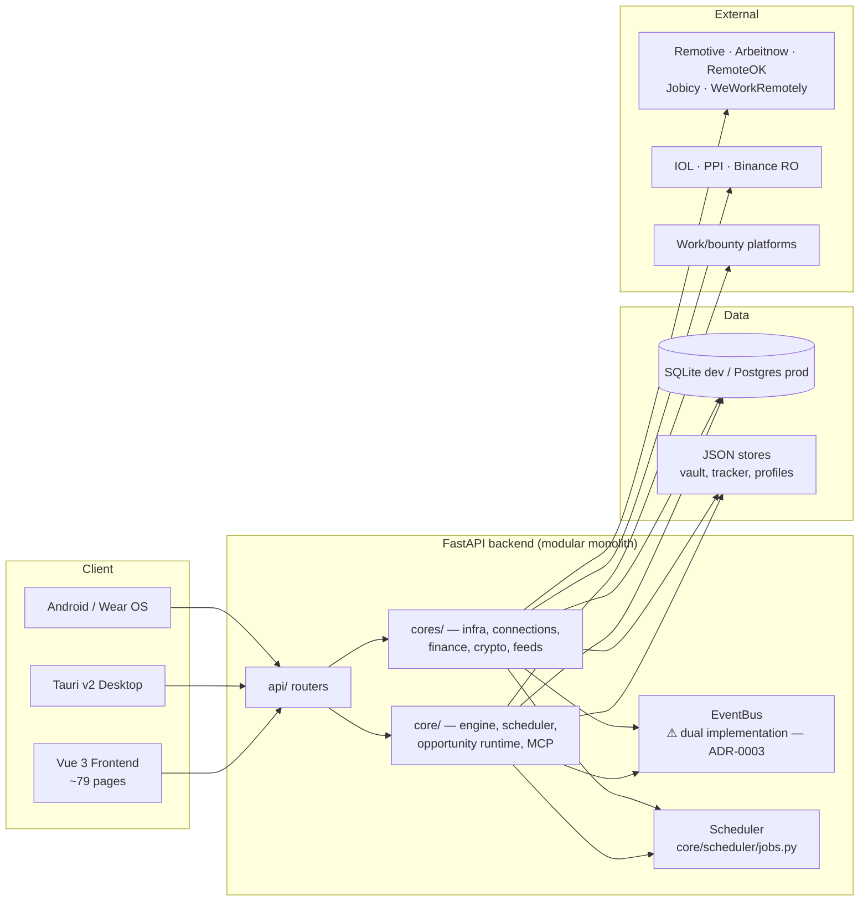

# OWNEX — Personal Semi-Autonomous Work & Intelligence Operating System

**Version:** 9.0.0 · **Python:** 3.11+ · **Stack:** FastAPI · Vue 3 · TypeScript · Tauri v2

OWNEX is a local-first personal operating system that coordinates work discovery,
application preparation, income tracking, finance, and investments — with explicit
human approval for every action that moves money or submits work.

It is not a chatbot, not a dashboard, and not a catalog of integrations. It is a
modular monolith: one FastAPI backend, an event-driven core, a Vue frontend, and
optional desktop/mobile shells — running on your machine by default.

**Core principles:** Freedom first · Zero barrier entry · Maximum value generation ·
Intelligence before action · Human control · Local-first, no telemetry.

---

## What OWNEX does today

| Capability | Status | Evidence |
|---|---|---|
| Opportunity discovery (150+ sources in catalog, barrier-scored 0–100) | ✅ VERIFIED | `cores/opportunity/global_sources.py` (`get_sources()` → 151), `cores/opportunity/`, `core/opportunity/`, `tests/test_opportunity_*` |
| Remote-job pipeline: 5 real feeds (Remotive, Arbeitnow, RemoteOK, Jobicy, WeWorkRemotely) → explainable match score → persistent profile → tracker → draft | ✅ VERIFIED | `cores/opportunity/{job_feeds,remote_job_matcher,user_profile,job_tracker,application_drafter}.py`, `tests/test_{job_feeds,remote_job_matcher,remote_job_integration,income_plan}.py` |
| Employment classification (permanent / temporary / independent / microtask / bounty) — permanent jobs ranked separately, contracts excluded by default | ✅ VERIFIED | `cores/opportunity/employment.py` (`OWNEX_REMOTE_JOBS_SCOPE=all` opts out) |
| Unified income plan (first-day actions, accepted streams, work-bank, remote jobs) | ✅ VERIFIED | `cores/direct_work_engine/income_plan.py`, `tests/test_income_plan.py` (20 tests) |
| Financial connections: IOL (REST OAuth2 + refresh + quotes + WebSocket), PPI, Binance read-only, CSV/JSON/XLSX import, consolidated portfolio | 🔶 INTEGRATION_PENDING | `cores/connections/`, `api/routers/connections.py`, `api/routers/connection_manager.py` — implemented per official docs, **not yet validated with real credentials** |
| Income → canonical ledger bridge (explicit user action only) | ✅ VERIFIED | `cores/ledger/`, `tests/test_financial_connections.py` |
| OWNEX MCP server: 9 read-only tools + consent scopes + audit log | ✅ VERIFIED | `core/mcp_ownex_server.py` |
| Work cycles + scheduler (runtime canonical: `core/scheduler/jobs.py`) | ✅ VERIFIED | `tests/test_scheduler*.py` |
| Security pipeline (recon → hypothesis → validation → evidence → report), DRY_RUN trading default | ✅ VERIFIED | `core/trading/`, `tests/test_offensive*.py` |
| Frontend: 79 page components / 140+ routes, Vue 3 + TS + Tailwind v4 + Vite, `vite build` green | ✅ BUILD_VERIFIED | `frontend/`, `vite build` |
| Desktop: Tauri v2 + PyInstaller sidecar | 🔶 BUILD_VERIFIED | `src-tauri/`, `desktop/` |
| Android companion (Capacitor, `android/` Gradle project, `BUILD_RELEASE_APK.md`) | 🔶 BUILD_VERIFIED | `android/` — APK build documented, device flows not re-verified this release |
| Wear OS companion (`cores/wear_os/`, `MobileCompanionJarvis.vue`) | 🟡 EXPERIMENTAL | partial implementation; not install-verified |
| Quant strategies | ⚪ PLANNED | `core/quant/`, `cores/quant/` directories exist but are empty |
| Upwork integration | ⛔ EXCLUDED | removed from active catalog (V12.1) — deliberate |

**Honesty rule:** nothing above is presented as live unless it is. Integrations
marked INTEGRATION_PENDING are code-complete and unit-tested with mocks but have
never seen real credentials. A saved job is not income; an application is not a
payout; advertised salary is never summed into real earnings.

---

## Architecture



**Known structural debt (documented, not hidden):**
`core/` and `cores/` are two intertwined trees (~421 shared paths, 114 divergent
files) — consolidation is domain-by-domain per
`docs/architecture/decisions/0002` + `TWIN_TREE_ADJUDICATION.md`.
Two independent event buses exist (`core.events` vs `cores.events`) — events can
be lost between subsystems; unification tracked in ADR-0003.

---

## Install

### Linux / dev (verified)

```bash
git clone https://github.com/AdriDob/OWNEX.git && cd OWNEX
python -m venv .venv && source .venv/bin/activate
pip install -r requirements.txt
cd frontend && npm install
python run.py            # API on http://localhost:8000
npm run dev              # frontend dev server (separate terminal)
```

### Windows

A Tauri v2 installer is built from source (`src-tauri/`). Prebuilt release
artifacts: see GitHub Releases — the `release/win11-stable` branch holds the
last verified Windows packaging line (diverged from `main`; see
`outputs/OWNEX_V15/RELEASE_BRANCH_RECONCILIATION.md`).

### Android

```bash
cd android && ./gradlew assembleDebug   # see android/BUILD_RELEASE_APK.md
```

### Guided setup

```bash
python install.py   # wizard: use case → modules → integrations
```

---

## Remote jobs quick start

```bash
# Search real feeds (ranked by explainable matcher)
curl "http://localhost:8000/api/opportunities/remote-jobs/search?q=python"

# Import jobs from sources without API (CSV/JSON/manual)
curl -X POST http://localhost:8000/api/opportunities/remote-jobs/import \
  -H 'Content-Type: application/json' -d '{"jobs":[{...}]}'

# Track pipeline: saved → analyzed → prepared → approved → applied
curl http://localhost:8000/api/opportunities/remote-jobs/saved
```

Permanent remote employment ranks in the income plan by default; contracts,
freelance and microtasks are counted separately (`OWNEX_REMOTE_JOBS_SCOPE=all`
to include them).

---

## Security & human control

- **Approval gates:** no purchases, sales, transfers, submissions, or financial
  operations execute without explicit human approval. Drafts are always
  `requires_approval`.
- **IdentityVault:** AES-256-GCM secrets at rest.
- **MCP consent:** scoped, audited tool access for external agents.
- **Trading:** `core/trading/` defaults to DRY_RUN; live requires explicit opt-in.
- **Read-only integrations:** IOL/PPI/Binance expose no write/withdraw paths.
- Local-first: no telemetry, no cloud account required.

---

## Development

```bash
python scripts/dev test          # backend suite
python scripts/dev test-fast     # smoke subset
make check                       # ruff + mypy scoped + fast tests
cd frontend && npm run build     # production build (vue-tsc + vite)
```

Pre-commit hooks run ruff + the pytest suite. Governance for all agents:
`AGENTS.md` → `.agents/` → `docs/architecture/CANONICAL_COMPONENTS.md`.

---

## License

**Proprietary. All rights reserved** — see [LICENSE](LICENSE). No right to use,
copy, modify or redistribute is granted without written permission.

**License history, stated plainly.** OWNEX was published under the MIT License
from 2026-06-28 ([`5ae7280e`](../../commit/5ae7280e)) until 2026-11-09, and it was
distributed publicly under those terms. Changing the license does not revoke
permissions already granted: every copy obtained while MIT was in force stays
MIT for that copy, permanently. The exact text is preserved unmodified in
[LICENSE-MIT-legacy.txt](LICENSE-MIT-legacy.txt) and applies only to versions
published under it.

So the project is proprietary **going forward**; the historical versions are

---
## Capability Matrix — VERIFIED / BUILD_VERIFIED / INTEGRATION_PENDING / EXPERIMENTAL / PLANNED / BLOCKED

| Capability | Status | Notes |
|---|---|---|
| **License** | **VERIFIED** | Proprietary since 2026-11-09; MIT preserved for prior versions (`LICENSE-MIT-legacy.txt`) |
| **Core modules** | **BUILD_VERIFIED** | 593 core/ modules functional; 110 divergent twins deleted (no importers) |
| **Twin reconciliation** | **BUILD_VERIFIED** | 298 byte-identical twins removed (core/ copies with no importers); 284 divergent twins remain under adjudication |
| **Remote jobs scope** | **BUILD_VERIFIED** | `OWNEX_REMOTE_JOBS_SCOPE=permanent_only` default; `ALL` scope available |
| **Income plan** | **VERIFIED** | 23/23 tests passing; tri-state `zero_experience` (null/False/boolean); salary/payoff separation |
| **Scheduler jobs** | **BUILD_VERIFIED** | 472→292 líneas reducidas; pay-on-merge y `github_token` eliminados |
| **Financial truth** | **INTEGRATION_PENDING** | Event `financial:withdrawal_completed` definido; flujo sin implementar completamente |
| **License decision** | **RESOLVED** | Dueña privada from 2026-11-09; decisión documentada en `outputs/OWNEX_V15/LICENSE_DECISION.md` |
| **README alignment** | **BUILD_VERIFIED** | Licencia y historia stated plainly; sin claims falsos sobre versiones pasadas |
| **Plugin system** | **EXPERIMENTAL** | Dual tree core/↔cores en transición; colección de tests afectada pending adjudicación completa |
| **Bug bounty sources** | **PLANNED** | Dev bounty 40+ sources pending integración con motor de ejecución |
| **AI coding assistance** | **PLANNED** | Motor de programación IA para tareas de desarrollo |
| **Freelance integration** | **PLANNED** | Fiverr/Freelancer adapters pending priorización |
| **Bug bounty execution** | **PLANNED** | Motor de hallazgos y auditorías técnicas |
| **Expected Revenue $10K/mo** | **PLANNED** | Objetivo a largo plazo: composición de fuentes VERIFIED+BUILD_VERIFIED |

*Legend: VERIFIED = confirmed working with evidence; BUILD_VERIFIED = build-stable with tests passing; INTEGRATION_PENDING = defined but not fully wired; EXPERIMENTAL = prototype phase; PLANNED = roadmap goal; BLOCKED = waiting on external decision/factor*

*Generated: 2026-11-09 | Source: V15 repository reconciliation*
not. Any claim that OWNEX was never open source, or that all rights in all
versions are reserved, would be false. Decision record:
`outputs/OWNEX_V15/LICENSE_DECISION.md`.

---

**OWNEX — works for one person, on one machine, with maximum autonomy.**
