# Engineering Factory Loop — OWNEX v1.0

## Loop Estructurado: Planner → Implementer → Reviewer → Tests → Draft PR → Aprobación

El Engineering Factory loop es el motor de procesamiento de bounties y tareas de desarrollo. Cada etapa recibe la salida de la anterior y la pasa a la siguiente, con persistencia en la base de datos SQLite.

### Estados del State Machine

```python
PIPELINE_SEQUENCE: list[PipelineState] = [
    PipelineState.DISCOVERY,      # 0: Análisis inicial
    PipelineState.VALIDATION,     # 1: Validación de claims
    PipelineState.EVIDENCE,       # 2: Recopilación de evidencia
    PipelineState.AI_REVIEW,      # 3: Revisión de IA
    PipelineState.READY,          # 4: Listo para submit (manual review)
    PipelineState.SUBMITTED,      # 5: Enviado a plataforma
    PipelineState.TRIAGED,        # 6: Triado por plataforma
    PipelineState.PAID,           # 7: Pago confirmado
    PipelineState.CLOSED,         # 8: Cierre final
    PipelineState.FAILED,         # 9: Falló
    PipelineState.CANCELLED,      # 10: Cancelado
]
```

### Flujo de Etapas del Engineering Factory

| Etapa | Estado | Agente Responsable | Salida | Handoff |
|-------|--------|-------------------|--------|---------|
| **1. Planner** | `DISCOVERY` → `VALIDATION` | `PlannerAgent` | Plan descompuesto, objetivos claros | → CoderAgent |
| **2. Implementer** | `VALIDATION` → `EVIDENCE` | `CoderAgent` | Código generado, fixes aplicados | → ReviewerAgent |
| **3. Reviewer** | `EVIDENCE` → `AI_REVIEW` | `ReviewerAgent` | Revisión de código, calidad score, aprobación/denegación | → Commander o auto-submit |
| **4. Tests** | `AI_REVIEW` → `READY` | `QAAgent` + `TestingSuite` | Tests pasados, cobertura >= 80%, sin regressions | → READY state |
| **5. Draft PR** | `READY` → `SUBMITTED` | `PRBuilder` | PR creado (draft si confidence < 0.7, sino PR completo) | → Plataforma |
| **6. Approval** | `SUBMITTED` → `TRIAGED` | Plataforma externa + `CoordinatorAgent` | Acceptado/Rechazado por platform | → TRIAGED |

### Agentes y sus Roles

#### `PlannerAgent`
- **Primary**: Create detailed plans for complex objectives
- **Tools**: task_decomposition, resource_estimation, dependency_resolution, timeline_optimization
- **Handoff to**: All specialists (based on plan requirements)
- **Handoff conditions**:
  - requires_research → research
  - requires_coding → coder
  - requires_browser → browser
  - requires_security → security

#### `CoderAgent` / Implementer
- **Primary**: Generate, refactor, and implement code
- **Tools**: code_generation, refactoring, pr_creation, testing, linting
- **Handoff to**: Reviewer, Documentation
- **Conditions**:
  - code_review_needed → reviewer
  - documentation_needed → documentation

#### `ReviewerAgent`
- **Primary**: Review code and changes for quality
- **Secondary**: Grant/deny approvals, ensure standards compliance
- **Tools**: code_analysis, quality_check, security_review, approval_system
- **Limits**: Max 8 concurrent reviews, Max 300s per review
- **Priority level**: 4
- **Handoff to**: Commander (approval), Documentation
- **Approval granted** → commander auto-submit
- **Approval denied** → bloqueado, requiere rehacer

#### `QAAgent` / Tests
- **Primary**: Validate code quality, run test suite
- **Tools**: pytest integration, coverage analysis, regression testing
- **Quality thresholds**: 
  - Test coverage >= 80%
  - No failing tests
  - No new regressions
  - Security scan clean

### Transiciones de Estado (State Machine)

```mermaid
flowchart TD
    A[DISCOVERY] -->|plan generated| B[VALIDATION]
    B -->|code implemented| C[EVIDENCE]
    C -->|review completed| D[AI_REVIEW]
    D -->|tests passed| E[READY]
    E -->|draft PR| F[SUBMITTED]
    F -->|platform response| G[TRIAGED]
    G -->|paid| H[PAID]
    H -->|closed| I[CLOSED]
    
    style A fill:#e3f2fd,stroke:#1976d2
    style B fill:#bbdefb,stroke:#1976d2
    style C fill:#90caf9,stroke:#1976d2
    style D fill:#64b5f6,stroke:#1976d2
    style E fill:#2196f3,stroke:#1976d2
    style F fill:#1e88e5,stroke:#1976d2
    style G fill:#1565c0,stroke:#1976d2
    style H fill:#0d47a1,stroke:#1976d2
    style I fill:#0b483c,stroke:#1976d2
```



### Condiciones de Aprobar/Rechazar

#### Auto-approval gates:
1. **Elite finding**: Quality score >= 0.85 + elite gate passed
2. **Never submit without approval**: Configurable flag `CATEYE.never_submit_without_approval`
3. **Auto-approve elite**: `auto_approve_elite` threshold config

#### Manual review required:
- Quality score < 0.70
- New dependencies introduced
- Breaking changes
- Security flags raised
- Confidence < 0.7 on fix

### Calidad y Métricas

| Métrica | Umbral Mínimo | Umbral Óptimo |
|---------|--------------|---------------|
| **Quality Score** | 0.60 | 0.85 |
| **Test Coverage** | 70% | 90% |
| **Security Scan** | 0 critical findings | 0 findings |
| **Regression Tests** | All pass | All pass + performance |
| **Confidence (Coder)** | >= 0.50 | >= 0.80 |

### Ejecución Real

El loop se ejecuta mediante `CoordinatorAgent` que:

1. **Recibe** `PIPELINE_START` event
2. **Secuencia** las stages a través del state machine (11 estados)
3. **Persiste** cada transition en `PipelineRun.state_history` (SQLite)
4. **Computa** quality_score from transition history
5. **Retry** failed stages con exponential backoff (30s, 60s, 120s, 240s...)
6. **Emite** eventos en cada transición para que agentes escuchen y actúen

### Flujo Completo (Happy Path)

```
Pipeline Start
    ↓
Planner: Análisis y plan (DISCOVERY → VALIDATION)
    ↓
Coder: Implementación código (VALIDATION → EVIDENCE)
    ↓
Reviewer: Revisión y aprobación (EVIDENCE → AI_REVIEW)
    ↓
Tests: Ejecutar suite completa (AI_REVIEW → READY)
    ↓
PR Builder: Crear PR (draft if confidence<0.7) (READY → SUBMITTED)
    ↓
Platform: Submit bounty (SUBMITTED → TRIAGED)
    ↓
Payment: Confirmar pago (TRIAGED → PAID)
    ↓
Close: Cierre final (PAID → CLOSED)
```

### Estado Actual

- ✅ PlannerAgent implementado y testeado
- ✅ CoderAgent implementado con PRBuilder integrado
- ✅ ReviewerAgent implementado con sistema de approval
- ✅ State machine completa (11 estados validados)
- ✅ CoordinatorAgent con persistence en SQLite
- ✅ PR creation via GitHub API (draft y full PR)
- ⚠️ QA/testing integration pending (tests exist but not auto-triggered in loop)
- ⚠️ Platform submission (HackerOne/BugCrowd) pending credentials
- ⚠️ Auto-approval gates config pending

### Próximos Pasos para Completo

1. **Integrar QA/tests auto-trigger** después de Reviewer approval
2. **Configurar auto-approval gates** (elite threshold, never_submit flag)
3. **Conectar platform submission** (HackerOne, BugCrowd APIs)
4. **Implementar retry logic** en Coordinator para stages failed
5. **Añadir métricas de calidad** en dashboard

### Verificación

```bash
# Run engineering factory tests
python3 -m pytest tests/test_engineering_factory.py -v

# Verify state machine transitions
python3 -c "from cores.agents.types import PipelineState; from cores.pipeline.state_machine import validate_transition, next_stage; print('Sequence:', len(PipelineState.PIPELINE_SEQUENCE), 'states')"

# Test PR creation
python3 -c "from cores.autonomy.pr_builder import create_pr_from_plan; print('PRBuilder imported successfully')"
```

## Revenue Integration

El Engineering Factory loop alimenta directamente el **Revenue Validation**:

1. **Each completed cycle** → 1 stage demonstrated (of 8 total)
2. **Quality score >= 0.85** → elite finding → counts as 2 stages
3. **Platform acceptance** → 3rd stage demonstrated
4. **Payment received** → 4th+ stages demonstrated

Los 8 etapas del Revenue Validation se mapean como:
1. Discovery phase completed
2. Evidence collected  
3. Code fix implemented
4. Code reviewed & approved
5. Tests passed
6. PR submitted to platform
7. Platform triages finding
8. Payment received

Actual checkpoint: **28,7%** (2 de 8 etapas demostradas según informe actual).